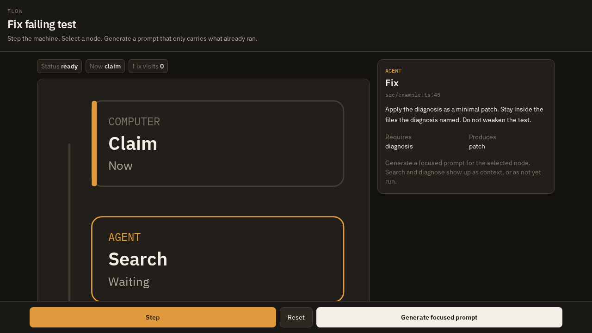

# Flow

A right-hand Herdr panel that draws one agent workflow as a vertical state machine. Computer nodes are neutral, agent nodes use the accent color, the retry loop and the error exits sit under the node that owns them, and the selected node's prompt is pinned at the bottom with a Generate focused prompt button.

## What you see

The panel is about 420px wide, docked on the right (`mods/flow/mod.json`, `"place": "right"`, `"size": 420`, `"focusable": true`). It uses the theme: canvas behind the graph, chrome for the header, surface for the detail.

Top to bottom:

1. Header on `chrome`. Small "FLOW" label in `dim`, title "Fix failing test" at 16px semibold, then one status line in `muted`: run status, the active node, Fix's visit count, and the last note (a retry or an error exit).
2. A row of 28px actions: Step (solid), Reset, One miss / Burn retries, Reload.
3. A scrolling canvas. A 2px spine in `border` runs down the left. Each node is a 248×84 card at x=48. Computer cards use `border`; agent cards use `accent`. The selected card uses `foreground`. The active card uses `selected` as its fill and its status line says "now". A card that has run says "ran ×N".
4. Under Fix, an accent pill: `loop · retries < 5`. Under Fix, a red pill (`#c4544a`): `max retries exceeded`. Under Verify, a red pill: `tests still failing`. A pill that has fired fills solid red.
5. Detail block on `surface`, top border `border`. Node label, kind, source `file:line`, the prompt text, requires, produces, and the solid button "Generate focused prompt". A one-line banner, then the generated markdown (up to 18 lines) when there is one.

Done is the forward exit. Gave up sits under it on the spine. Nothing uses HTML or CSS.

## How it behaves

- The example machine is claim → search → diagnose → fix → verify → judge → done. Judge can reject to gave-up. Verify can return to fix on "tests still failing". Fix has a self-loop labeled "retries < 5".
- Step executes the active node, stores its output in the run context, increments that node's visit count, and moves. One miss makes Verify fail once, so Fix runs twice, then the tests pass and the run ends on Done. Burn retries makes Verify keep failing until Fix has been visited 5 times; the next failure takes the "max retries exceeded" exit and lands on Gave up.
- Reset clears completed nodes, visits, context, and the prompt.
- Clicking a card selects it. Fix is selected when the panel opens, so the detail and the generate button are on screen immediately.
- Generate focused prompt builds markdown: a header with the node id, kind, and source; the node's prompt; "Context from prior steps" with outputs of nodes that already ran and, for ancestors that have not, their description plus "not yet run"; a warning listing any `requires` key missing from the context. Search and diagnose are ancestors of Fix, so they always appear in that section.
- The markdown is copied with `cx.write_to_clipboard` and, if present, `wl-copy`, `pbcopy`, or `xclip`. It is also written to `~/.config/herdr-app/data/focused-prompt.md`.
- Step and Reset also write `data/flow-run.json` (machine plus active node, completed nodes, visit counts) and `data/machines/fix-failing-test.json`.
- Reload reads that machine file, parses it, and redraws. Adding a node and a transition there, then Reload, shows the new card. Editing `src/example.ts`, running `npm run emit`, and saving the mod does the same, because the panel constructs the example from code on each load.
- `herdr-app check` renders this initial view and does not write files or start the clipboard helper (`checking()` returns first).

## Built from

- `mods/flow/main.js` — a `View` from `gpui-kit`. Layout with `div`, `v_flex`, and `h_flex` from `gpui-kit` / `gpui-base`. Cards and pills are absolutely placed from `layoutGraph`.
- `mods/flow/lib/*.js` — emitted from `src/`. Herdr imports `./lib/example.js`, `./lib/layout.js`, `./lib/prompt.js`, `./lib/runner.js`.
- `src/types.ts` — `Machine`, `MachineNode`, `Transition`, `ErrorExit`, `RunState`.
- `src/example.ts` — the fix-failing-test machine. Every node has `source: { file: "src/example.ts", line }` on the line that sets its `id`. `simulateFixFailingTest` produces the claim, findings, diagnosis, patch, test result, and verdict.
- `src/runner.ts` — `createRun`, `step`, `exportSnapshot`, `parseMachine`. `step(..., { structural: true })` walks only forward edges.
- `src/graph.ts` — start node, display order, ancestors (forward edges only), retry budget from `retries < N`.
- `src/layout.ts` — spine, node boxes, loop pill, error pills.
- `src/prompt.ts` — `buildFocusedPrompt`.
- herdr: `theme`, `appHome`, `readTextFile`, `writeTextFile`, `exec`, `checking`. No network. `exec` is only `mkdir -p ~/.config/herdr-app/data/machines` and the clipboard fallback.

## Watch out

- `writeTextFile` is compare-and-swap. The panel reads the file first and passes that text as `expected`, then retries with `null` if the first write is refused.
- Clipboard fallback shells out to `wl-copy`, `pbcopy`, or `xclip`. On a machine with none of them, the prompt is still in `focused-prompt.md` and in the detail pane. `cx.write_to_clipboard` is tried first when the context has it.
- Do not call `writeTextFile` or `exec` while `checking()` is true; the check warns and the initial render must stand on the in-memory machine.
- Parents for the data files are created with `mkdir`. The panel never writes outside `~/.config/herdr-app/data/`.
- Absolute positions come from `layoutGraph`. If a future Herdr build drops `.absolute()` / `.left()` / `.top()`, the same layout can be stacked with `v_flex` in the same order.
- Shipped mods update on start. This one is personal: keep it in `mods/flow`, not in a folder Herdr owns.

## Done when

- `herdr-app check ~/.config/herdr-app/mods/flow` exits 0.
- The example machine's snapshot JSON lists eight nodes, the `retries < 5` loop, and both error exits.
- The canvas shows the loop pill and both red error exits. Agent cards are accent; computer cards are neutral.
- Select Fix, press Generate focused prompt before stepping: the prompt names Search and Diagnose as not yet run and warns that `diagnosis` is missing.
- Step through Claim, Search, and Diagnose, then generate again: the prompt includes the search findings and the diagnosis, and the warning is gone.
- The prompt is on the clipboard and in `~/.config/herdr-app/data/focused-prompt.md`.
- The detail shows `src/example.ts` and a line number for the selected node.
- Add a node and a transition to the machine JSON, press Reload: a new card appears. The same happens after editing `src/example.ts`, `npm run emit`, and a mod reload.
- `npm test` passes the same checks against `src/`.
